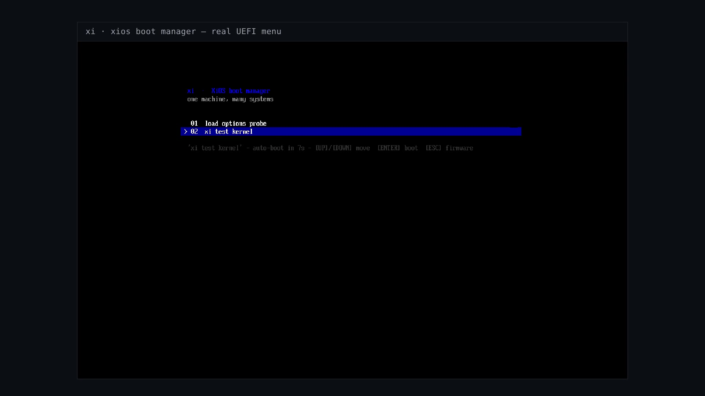

# XiOS

_Brand: **xi** — Xi Hub Operating System_

> **One machine. Many systems.**

XiOS is a **container-style OS hub for laptops and desktops**. Your computer always
boots into **XiOS** — a lightweight base OS — and XiOS manages up to **5 standalone
operating systems** (Linux Mint, Android-x86, Fedora, anything that exists as an
installer ISO) in isolated KVM virtual machines, each with its own virtual disk and
a defined resource budget.

**Your files are yours:** Documents, Downloads, Pictures, Music, Videos live with
XiOS itself and are **shared into every slot** via virtiofs. Switch from Mint to
Android — same files. Like Docker volumes, but for whole operating systems.

**Mental model: XiOS is to laptops what Docker is to servers.**

## The launch video

[](https://github.com/chlkdvn/xios/raw/main/docs/brag/brag.mp4)

_*(click the image to watch `docs/brag/brag.mp4` — ~4 MB)*_

> **XiOS: one machine, many systems.** Five OS slots with their own CPU/RAM/disk,
> their own UEFI boot manager, and a web panel that looks like neofetch.
> It boots. It runs. It is yours.

---

## What's in this repo

```
XiOS/
  SPEC.md      ← the full project spec / design document
  xi/          ← `xi`, the slot manager CLI (Rust): KVM slots + web panel
  bootloader/  ← Xi boot manager (Rust, x86_64 UEFI) built for the ESP
  docs/        ← screenshots & extras
```

## Quick start — install it, run your first OS in 10 minutes

Tested on Ubuntu 22.04/24.04 · x86_64 with virtualization (VT-x/AMD-V) enabled.

### 1. Install the prerequisites

```bash
sudo apt update
sudo apt install -y build-essential qemu-system-x86 qemu-utils virtiofsd
curl --proto '=https' --tlsv1.2 -sSf https://sh.rustup.rs | sh   # Rust
source "$HOME/.cargo/env"
```

Check that KVM is available (this is what makes slots run at native speed):

```bash
ls -l /dev/kvm    # if missing, enable virtualization in your BIOS/UEFI
```

### 2. Build the `xi` CLI

```bash
git clone https://github.com/chlkdvn/xios.git
cd xios/xi
cargo build --release
./target/release/xi version        # xi 0.1.0
sudo cp target/release/xi /usr/local/bin/   # optional: install on PATH
```

### 3. Register a slot (name it, give it a budget)

Download any distro installer ISO — e.g. Linux Mint — then:

```bash
xi add mint --iso ~/Downloads/linuxmint.iso --cpu 4 --ram 4096 --disk 32
# defaults if you omit them: 2 CPUs · 4096 MiB RAM · 32 GiB disk
# xi add mint --iso ~/Downloads/linuxmint.iso     ← is enough
```

### 4. Install that OS into the slot (like `docker build`, but for an OS)

```bash
xi run mint
```

A window opens and it boots the Mint installer **inside a VM** — the installer
looks exactly like installing on a normal laptop. Install as usual, then shut
the VM down from inside Mint.

**Nothing on your real machine is touched** — the OS installs to the slot's
own virtual disk (`~/.xios/disks/mint.qcow2`).

### 5. Run the installed OS

```bash
xi run mint        # boots from disk — your whole screen is Linux Mint
```

To boot from disk instead of the installer CD on later runs, re-register the
same slot name *without* `--iso` — the installed disk is kept:

```bash
xi rm mint && xi add mint --cpu 4 --ram 4096 --disk 32 && xi run mint
```

(Works because `xi rm` only unregisters — `~/.xios/disks/mint.qcow2` survives.)

### 6. Everyday commands

```bash
xi list                    # all slots + which are running
xi status                  # host CPU/RAM/disk + slot overview
xi run mint                # boot a slot (window titled "xios:mint")
xi run mint --headless     # boot without a window
xi stop mint               # stop a running slot
xi rm mint                 # unregister the slot (files in ~/XiShared untouched)
xi serve                   # web panel → http://127.0.0.1:7747
xi help | xi version
```

### 7. Files shared with all your slots

Everything in **`~/XiShared`** on the host appears inside **every** running
slot (virtiofs). Save a file on your host → it's there in Mint, in Android-x86,
wherever you boot. Only slot *system* disks get deleted, ever.

### Where state lives

`~/.xios/` — set `XIOS_HOME` to relocate:

- `slots.txt` — slot registry (`slot|cpu|ram|disk|iso`)
- `disks/` — qcow2 slot disks
- `isos/` — Xi Store downloads
- `run/` — live VM pidfiles
- `log/xi.log` — operation log

Exit codes help scripts: `0 ok · 1 general · 2 bad args · 3 missing dep ·
4 unknown slot · 5 qemu failed · 6 already running · 7 bind failed`.

### Build the UEFI boot manager (optional)

```bash
cd bootloader
rustup toolchain install nightly
rustup target add x86_64-unknown-uefi --toolchain nightly
cargo +nightly build --release
```

The resulting `.efi` file is dropped into the ESP by the image build scripts.

### Build the UEFI boot manager

```bash
cd bootloader
rustup switch bootmanager +nightly
rustup target add x86_64-unknown-uefi
cargo build --release
```

The resulting `.efi` file is dropped into the ESP by `mkimage.sh`.

---

## How an OS gets in (two ways, identical result)

### A. Flash drive (the familiar way)

1. Plug a USB stick containing a distro installer ISO.
2. XiOS detects it and shows the **slot wizard**: name + resource budget.
3. XiOS creates a fresh virtual disk and boots the installer in a VM with the
   USB passed through — the installer looks *exactly* like a normal install.
4. **The one critical difference:** it installs onto the slot's virtual disk.
   Your SSD is never touched. Nothing is ever wiped.

### B. Xi Hub (downloads inside XiOS)

Same wizard, but XiOS fetches the official ISO itself, verifies the checksum,
and starts the installer. No USB needed.

After install, the slot appears in the picker:

```
xi run mint   →  your whole screen is Linux Mint
```

Exit the VM → you fall back into XiOS.

## Resource model

Every slot declares a budget:

```
mint:     cpu 4   ram 8G   disk 64G
android:  cpu 2   ram 4G   disk 16G
fedora:   cpu 2   ram 4G   disk 24G
```

- The base OS + idle slots cost almost nothing (~300 MB RAM total).
- Running slots strictly honor their caps — a runaway OS can't starve the host.
- The **sharedFolders** rule is invariant: every slot sees the same `/home/xi/*`.
- Deleting a slot deletes that slot's *system disk only* — never your files.

## Architecture

```
                  boot firmware (UEFI)
                          │
                   XiOS base OS  ◄── small, fast, quiet
                          │
   ┌──────────────────────┼──────────────────────┐
   │                      │                      │
xi CLI / Picker      Slot Manager           Xi Hub (store)
(TUI, later GUI)     (libvirt + KVM)        (ISO library)
   │                      │
   │             ┌────────┴─────────┐
   │             │ virtiofs bridge  │  shared: /home/xi/*
   │             └────────┬─────────┘
   └── slot VM 1 ────────┴── slot VM 2 ── ⋯ slot VM 5
    (Mint)               (Android-x86)
```

## Why Rust for the tooling?

`xi` is a *control-plane* program: it deletes disk images, launches VMs, runs
concurrent tasks, and handles untrusted ISO data. Rust's memory- and
thread-safety guarantees make that safe by construction. The heavyweight work
(actual virtualization) happens in KVM/QEMU — `xi` just commands it.

## Roadmap

| #  | Milestone                            | You get                                                     |
|----|--------------------------------------|-------------------------------------------------------------|
| M1 | Slot engine on your machine          | `xi` CLI + first slot VM + shared folders working           |
| M2 | Slot wizard + Xi Hub                 | USB-in detection, ISO library, checksums, enforced budgets  |
| M3 | Picker boot UX                       | Full-screen picker at VM exit, slot usage stats             |
| M4 | XiOS ISO                             | Bootable Debian-based installer — any machine becomes XiOS  |
| M5 | Polish                               | Recovery mode, slot snapshots ("snapshot before risky")     |

## Non-goals (v1)

- No nested graphic managers, no cloud sync, no Apple Silicon support yet.
- Max slots: 5 — deliberate simplicity, not a technical limit.
- No proprietary driver blobs bundled into the XiOS ISO.

---

See [SPEC.md](SPEC.md) for the full design document.
